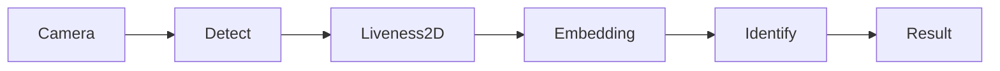

# Face Recognition SDK: On-Premise Face Recognition and Face Liveness Detection

All processing runs on the device or on your own server, never in Faceplugin's cloud, so face data stays under your control.

Faceplugin's face recognition algorithm (**faceplugin-000**) is independently tested by NIST in the [**FRTE 1:1 Verification**](https://pages.nist.gov/frvt/html/frvt11.html) benchmark (formerly FRVT). See the [NIST report card](https://face.nist.gov/frte/reportcards/11/faceplugin_000.html) and the results summary below. Server APIs run on **port 8083** (recognition) and **port 8084** (standalone liveness).

### NIST FRTE 1:1 Face Recognition Accuracy

The face recognition engine in the Face SDK was submitted to the U.S. **National Institute of Standards and Technology (NIST)** for its **Face Recognition Technology Evaluation (FRTE) 1:1 Verification** benchmark, previously known as **FRVT**. NIST tests submitted algorithms independently, on its own sequestered image datasets, and publishes a report card for each one.

|                       |                                                                                                   |
| --------------------- | ------------------------------------------------------------------------------------------------- |
| **Algorithm**         | faceplugin-000                                                                                    |
| **Evaluation**        | NIST FRTE 1:1 Verification (formerly FRVT 1:1)                                                    |
| **Submitted to NIST** | \[FILL IN: submission date from report card]                                                      |
| **Report card**       | [faceplugin\_000 on face.nist.gov](https://face.nist.gov/frte/reportcards/11/faceplugin_000.html) |


NIST does not endorse any product. Results apply to the algorithm version submitted for testing.


### Three Ways to Use the Face SDK

* [**Recognition**](recognition.md) — recognition-only server API on **8083** (`faceplugin/face-recognition`).
* [**Liveness**](../liveness-detection-sdk/) — standalone face presentation attack detection (PAD) for mobile and for servers on port 8084, with no face matching.
* [**Recognition + Liveness**](recognition-and-liveness.md) — mobile Identify with 2D liveness, plus server face matching and `/api/liveness` on port 8083. **Recommended for eKYC**.

### Face SDK Features

✅ Face Detection

✅ Face Landmark Detection

✅ Face Template Extraction

✅ Face Template Matching

✅ Live 1:N Identify (mobile)

✅ Liveness Detection (passive 2D on mobile Identify)

✅ Pose Estimation

✅ On-premise Face Recognition API (port **8083**)

### Choose a Face SDK Mode

Start with [Capabilities](capabilities.md), for an overview, then open the mode you need.

<table data-view="cards"><thead><tr><th></th><th></th><th></th><th data-hidden data-card-target data-type="content-ref"></th></tr></thead><tbody><tr><td></td><td><strong>Capabilities</strong></td><td>Recognition, liveness, and recognition + liveness in one place.</td><td><a href="capabilities.md">capabilities.md</a></td></tr><tr><td></td><td><strong>Recognition</strong></td><td>Recognition-only server (no /api/liveness).</td><td><a href="recognition.md">recognition.md</a></td></tr><tr><td></td><td><strong>Liveness</strong></td><td>Standalone face anti-spoofing on mobile and port 8084.</td><td><a href="../liveness-detection-sdk/">liveness-detection-sdk</a></td></tr><tr><td></td><td><strong>Recognition + Liveness</strong></td><td>Mobile + combined server — recommended for eKYC.</td><td><a href="recognition-and-liveness.md">recognition-and-liveness.md</a></td></tr></tbody></table>

### How to Call the Face Recognition SDK

#### Mobile (Android, iOS, Flutter, React Native, Ionic)

1. Set the license activation.
2. Initialize the SDK.
3. Detect faces and extract face templates.
4. Store templates in your own database.
5. Compare faces with `similarity`, or use VideoWorker for live 1:N identification.

**Default thresholds:** Identify **0.67**, Liveness **0.5**.

#### Server (Linux / Docker and Windows)

1. `GET /api/machinecode`: get the machine code for your license request.
2. `POST /api/activate`: activate the license.
3. `POST /api/detect`, `POST /api/match` or `POST /api/similarity`: detect faces and compare them.

> **Note:** The server API has no built-in 1:N gallery and no `POST /api/identify` endpoint. For server-side 1:N identification, store templates yourself, compare each probe with `/api/similarity` and pick the best match in your application.

### Face Recognition Use Cases

* **Access control:** enroll face templates, then run live 1:N identification at doors and gates (mobile).
* **Time and attendance:** enroll staff once, then match camera frames against your own database.
* **Face login for apps:** 1:1 selfie match against a stored template with `similarity` or `POST /api/match`.
* **eKYC selfie-to-ID match:** compare the portrait from an ID document with a live selfie, optionally together with the ID Document SDK and Face Liveness.
* **Fraud detection:** run still-image detection, matching and similarity checks on your own server (port 8083).

### Frequently Asked Questions

**Does the Faceplugin face recognition SDK work offline?**

Yes. After you activate it with a license key, face matching works with no internet connection.

**Is face liveness detection included?**

Mobile Identify includes passive 2D liveness. For standalone anti-spoofing, use the Face Liveness SDK. On the server, the combined Recognition + Liveness product provides both on port 8083.

**Is there a face recognition API?**

Yes. The face recognition API runs on port 8083 on Linux (Docker) and Windows. See the Recognition and Recognition + Liveness guides for setup.

**Does the server support 1:N face identification?**

Not as a built-in feature: there is no server gallery or `POST /api/identify`. Store templates in your database, compare each probe with `/api/similarity` and select the best match in your application. Live 1:N identification is built into the mobile SDKs.

**Has Faceplugin's face recognition been tested by NIST?**

Yes. Faceplugin's algorithm, faceplugin-000, is evaluated in NIST's FRTE 1:1 Verification benchmark (formerly FRVT). The full results are on its [NIST report card](https://face.nist.gov/frte/reportcards/11/faceplugin_000.html).

**What are the default face match and liveness thresholds?**

On mobile, the default Identify threshold is 0.67 and the default Liveness threshold is 0.5.

### Related documentation

* [Capabilities](capabilities.md) · [Recognition](recognition.md) · [Liveness](../liveness-detection-sdk/) · [Recognition + Liveness](recognition-and-liveness.md) · [ID Document SDK](../id-document-recognition-sdk/)
* [Request a License](../request-a-license-and-support.md) · [Try it](../resources/try-it.md) · [FAQ](../resources/faq.md) · [Glossary](../resources/glossary.md)
* [Combining products (eKYC)](../resources/choose-a-product.md) · [SDK comparison](../resources/comparisons/)
* [Status codes](../resources/status-codes.md)
