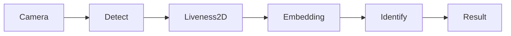

# Capabilities

What the Faceplugin **Face SDK** can do — **recognition**, **liveness**, and **recognition + liveness** — before you pick a platform.

| Mode                       | What you get                                            | Start install                                         |
| -------------------------- | ------------------------------------------------------- | ----------------------------------------------------- |
| **Recognition**            | Detect, templates, 1:1 match, mobile 1:N Identify       | [Recognition](recognition.md)                         |
| **Liveness**               | Standalone passive face anti-spoofing (no gallery)      | [Liveness](../liveness-detection-sdk/)                |
| **Recognition + Liveness** | Matching and `POST /api/liveness` in one server process | [Recognition + Liveness](recognition-and-liveness.md) |

### Face Recognition: 1:1 Matching and 1:N Identification

After you activate with a license key, face detection, template extraction, and matching run **offline** on the device or on **your** Windows/Linux host. Images are not sent to a Faceplugin cloud.

The algorithm is evaluated on **NIST FRVT** (as stated across Faceplugin Face Recognition docs).

| Mode             | Where             | How                                                                                                 |
| ---------------- | ----------------- | --------------------------------------------------------------------------------------------------- |
| **1:1**          | Mobile and server | Extract two templates → `similarity` / `POST /api/similarity`, or `POST /api/match` with two images |
| **1:N Identify** | Mobile demos      | VideoWorker + templates you store in **your** database (demo default match threshold **0.67**)      |

On **Linux / Windows**, the HTTP API is still-image **detect / quality / feature / match / similarity**. There is **no** server-side `POST /api/identify` gallery — you store templates and call similarity yourself.

`templateExtraction` / `POST /api/feature` generates face templates that you can store in **your own database**. Faceplugin does not host your users' face data or provide a cloud-based person gallery.

Mobile **1:N Identify** includes passive 2D liveness (default threshold **0.5**) as part of the identify flow. That is **not** the same as the standalone Liveness product below.

#### Face Recognition REST API (Port 8083)

| Route                  | Role          |
| ---------------------- | ------------- |
| `GET /api/machinecode` | Machine code  |
| `POST /api/activate`   | Activate      |
| `POST /api/detect`     | Detect faces  |
| `POST /api/quality`    | Quality       |
| `POST /api/feature`    | Template      |
| `POST /api/match`      | Two images    |
| `POST /api/similarity` | Two templates |

Image: `faceplugin/face-recognition`. See [Linux](face-recognition-linux-sdk.md) · [Windows](face-recognition-windows-sdk.md).

### Face Liveness Detection: Passive Anti-Spoofing (PAD)

Standalone **passive** presentation-attack detection: scores a camera frame or JPEG **without** a smile / turn-head challenge. These docs do **not** claim iBeta certification. Contact Faceplugin if you need a certification statement.

Detects attack types including:

* Printed photos
* Screen replays
* 3D models / masks
* Deepfake-style video (one type of spoof — not a separate deepfake product)

Score **≥ 0.5** → Real / pass (server default threshold in these docs).

| Surface             | Behavior                                                      |
| ------------------- | ------------------------------------------------------------- |
| **Android / iOS**   | Live camera + VideoWorker / `faceDetection` for anti-spoofing |
| **Linux / Windows** | `POST /api/liveness` with one RGB JPEG on port **8084**       |

**Example: check liveness with curl**

<pre class="language-bash"><code class="lang-bash"><strong>curl -s -X POST http://127.0.0.1:8084/api/liveness \
</strong>  -H 'Content-Type: application/json' \
  -d "{\"image\":\"$IMG\"}"
</code></pre>

Images: `faceplugin/face-liveness`. See [Linux](../liveness-detection-sdk/liveness-detection-linux-sdk.md) · [Windows](../liveness-detection-sdk/liveness-detection-windows-sdk.md).

### Face Recognition + Liveness in One Server

Run face recognition and anti-spoofing together in **a single container on port 8083**. It includes every recognition endpoint plus `POST /api/liveness`, which makes it the simplest server setup for eKYC.

* **Docker image:** `faceplugin/face-recognition-liveness-sdk`
* **Setup guides:** Linux · Windows

See [Linux](face-recognition-sdk-linux.md) · [Windows](face-recognition-sdk-windows.md).

#### Which Face SDK Mode Should I Choose?

| Need                                                      | Mode                                                              |
| --------------------------------------------------------- | ----------------------------------------------------------------- |
| Enroll / 1:N match (mobile Identify includes 2D liveness) | **Face Recognition**                                              |
| Anti-spoofing only (no gallery)                           | **Face Liveness**                                                 |
| Recognition + anti-spoofing in **one** server process     | **Face Recognition + Liveness**                                   |
| Document authenticity (ID spoof)                          | [ID Document SDK](../id-document-recognition-sdk/capabilities.md) |

### Supported Platforms

| Mode                   | Available as                                                                                                                                                |
| ---------------------- | ----------------------------------------------------------------------------------------------------------------------------------------------------------- |
| Recognition            | [Server SDK](server-sdk.md)(`faceplugin/face-recognition`) · [Open Source](open-source-windows-and-linux.md)                                                |
| Liveness               | [Mobile SDK](../liveness-detection-sdk/mobile-sdk.md) · [Server SDK](../liveness-detection-sdk/server-sdk.md) (**8084**)                                    |
| Recognition + Liveness | [Mobile SDK](mobile-sdk.md) · [Linux](face-recognition-sdk-linux.md) · [Windows](face-recognition-sdk-windows.md) · [.NET](face-recognition-dot-net-sdk.md) |

### Use cases

* **Access control and time attendance:** enroll face templates and run live 1:N identification at doors, gates and terminals.
* **eKYC selfie verification:** run passive anti-spoofing before, or together with, face matching.
* **Server-side fraud checks:** still-image detection, matching and similarity on port 8083, plus liveness on port 8084 or on the combined 8083 service.

### Frequently Asked Questions

**Can Faceplugin face recognition work fully offline?**

Yes. After license activation, face detection and matching run entirely on your device or server with no internet connection.

**Is there a face recognition API?**

Yes. The Face Recognition server exposes an HTTP REST API on port 8083, with endpoints for detection, quality, feature extraction, match and similarity.

**Is there a server-side 1:N face gallery?**

No. Store face templates in your own database and compare them with `/api/similarity`.

**What is the difference between Identify's 2D liveness and the standalone Liveness SDK?**

Identify builds 2D liveness into face matching on mobile. The standalone Liveness SDK does anti-spoofing only, on mobile or on the server at port 8084.

**What liveness score counts as a real face?**

A score of 0.5 or higher is treated as real. This is the default server threshold.

### Related documentation

* [Face SDK](./) · [Try it](../resources/try-it.md) · [Glossary](../resources/glossary.md)
* [ID Document capabilities](../id-document-recognition-sdk/capabilities.md)
* [Request a License](../request-a-license-and-support.md)
