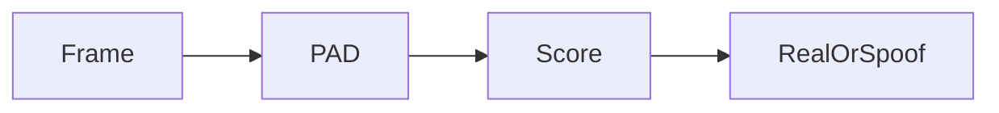

# Mobile

Standalone presentation-attack detection on Android and iOS. The demo scores whether the face is **real**. It does not enroll people or run 1:N search.

Live camera (VideoWorker plus `faceDetection`). Score **0.5 or higher** is treated as Real / pass.

If you already use Face Recognition Identify on mobile, that flow already includes **passive 2D liveness**. Choose this product when you need anti-spoofing **without** enrollment.

For JPEG-over-HTTP on Windows, Linux, and Docker, use [Server SDK](server-sdk.md).

<table data-view="cards"><thead><tr><th></th><th></th><th></th><th data-hidden data-card-cover data-type="files"></th><th data-hidden data-card-target data-type="content-ref"></th></tr></thead><tbody><tr><td></td><td><strong>Android SDK</strong></td><td>Native AAR. Liveness, Settings, and About screens.</td><td><a href="../.gitbook/assets/android.png">android.png</a></td><td><a href="liveness-detection-android-sdk.md">liveness-detection-android-sdk.md</a></td></tr><tr><td></td><td><strong>iOS SDK</strong></td><td>Three frameworks. Same anti-spoofing flow as Android.</td><td><a href="../.gitbook/assets/apple-logo-3-300x300.png">apple-logo-3-300x300.png</a></td><td><a href="liveness-detection-ios-sdk.md">liveness-detection-ios-sdk.md</a></td></tr></tbody></table>

### Frequently Asked Questions

**Is this active or passive liveness detection?**

Passive. There is no smile, head-turn or other challenge. The SDK scores a camera frame and returns real or spoof.

**What attacks does the mobile liveness SDK detect?**

Printed photos, screen replays, 3D masks and deepfakes.

**What score counts as a real face?**

A liveness score of 0.5 or higher is treated as Real (pass).

**Does the SDK do face recognition too?**

No. It is anti-spoofing only, with no enrollment or 1:N search. For recognition plus liveness, use the Face Recognition Mobile SDK.

**Does it work offline?**

Yes. Liveness detection runs entirely on the device.

### Related documentation

* [Capabilities](capabilities.md) · [Faceplugin Face Liveness Detection Server SDK](server-sdk.md) · [Face Liveness Detection SDK](./) · [Glossary](../resources/glossary.md)
* [Face Recognition Mobile SDK](../face-recognition-sdk/mobile-sdk.md)
* [Request a License](../request-a-license-and-support.md) · [Status codes](../resources/status-codes.md)
* [Combining products (eKYC)](../resources/choose-a-product.md) · [SDK comparison](../resources/comparisons/)
